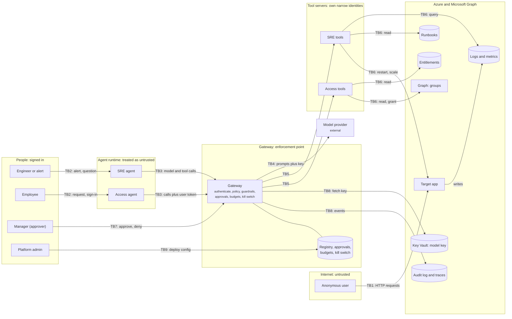

# Threat model

Version 1 (draft) · step 1.1 · started 2026-10-23

This document answers four questions for the Agent Governance Gateway and the two agents it protects: what are we building, what can go wrong, what will we do about it, and how will we know it works. Every threat names a planned control, the test that will prove it, and the plan step that builds it.

It describes the **target system** (Phases 1–6), not only what exists today. Parts of the design are still open; they are marked as such and the model is updated when they are decided.

**Method** (ADR 0006): draw the data flows and trust boundaries, apply STRIDE at each boundary, and tag each threat with its OWASP (LLM Top 10 2025, Agentic Top 10 2026) and Google SAIF categories. Likelihood and impact are rated Low / Medium / High.

## 1. Scope

**In scope:** the gateway, the SRE agent, the access-request agent, their tool servers, the target app they operate on, and the Azure and Microsoft Graph resources those tools touch.

**Out of scope for v1:**

- The coding agent used to build this project, and CI. They have their own controls (ADR 0004, repository rulesets, secret scanning).
- The security of Azure, Entra ID and the model provider's own infrastructure. We trust them, and record that as an accepted risk.
- A compromised maintainer laptop or Azure admin account. Whoever holds these owns the tenant anyway.

**Assumptions** (each is checked by a later step):

- Agents reach models and tools only through the gateway (proved in 1.5).
- Agents hold no secrets; the model key lives in Key Vault and only the gateway uses it (3.6).
- Tool servers act on Azure and Graph with their own narrow identities, never the agent's (6.2, 4.2).

## 2. The system

### Assets: what is worth protecting

| ID | Asset | What we care about |
|---|---|---|
| A01 | Target app | Stays up; is only restarted or scaled when that is the right fix |
| A02 | Group memberships in Entra ID | Only entitled people get access; privileged groups above all |
| A03 | Model API key | Never leaves Key Vault and the gateway |
| A04 | Identities and tokens: agent identities, tool-server managed identities, users' delegated tokens | Cannot be stolen, replayed or used by anyone else |
| A05 | Data the agents read: logs (may contain secrets and personal data), metrics, runbooks, entitlements, group details | Not leaked outside its audience |
| A06 | Gateway configuration: agent registry, approval records, budget counters, kill-switch flag | Only the platform admin can change it |
| A07 | Audit log and traces | Complete and unchangeable; the evidence of what happened |
| A08 | Money: model tokens and Azure spend | Bounded per agent and per run |
| A09 | Approvers' attention | Not worn down by floods of requests or misleading summaries |

### Actors: who is involved

| Actor | Trust | Notes |
|---|---|---|
| Engineer on call | Trusted | Starts SRE triage, reads its report |
| Alert system | Trusted source, untrusted content | Alert text can quote logs |
| Employee | Signed in, partly trusted | Uses the access agent; may be a malicious insider |
| Manager | Signed in, trusted to approve | Approves requests for groups they own |
| Platform admin (the maintainer) | Trusted | Owns gateway config, Terraform and the tenant |
| Anonymous internet user | Untrusted | Can send requests to the target app, and so write into its logs |
| Content author | Partly trusted | Anyone who can edit runbooks, alert rules, group descriptions or ticket text |
| Third-party code | Partly trusted | MCP SDKs, Python packages, a tool server we did not write |
| Model provider | Trusted with prompts | Sees everything the agents send to the model |
| **A hijacked agent** | **Untrusted** | The design assumes any agent can be turned by injected text, so the gateway treats agents as untrusted callers |

### Entry points: where input comes in

| ID | Entry point | Who controls the content |
|---|---|---|
| E01 | SRE trigger: an alert payload or an engineer's question | Alert system, engineer |
| E02 | Target app's public HTTP endpoints (headers, URL, form fields, login names) | **Anyone on the internet**; this text lands in logs |
| E03 | Runbooks | Content authors |
| E04 | Access request typed by a user | The employee |
| E05 | Group names and descriptions; request and ticket text | Content authors, employees |
| E06 | Tool results returned to the agent (carries E02, E03 and E05) | Whoever wrote the underlying data |
| E07 | Tool descriptions (`tools/list`) | Whoever wrote or controls the tool server |
| E08 | Model responses, including the tool calls the model asks for | The model, steered by everything above |
| E09 | Gateway API (agent calls) | Agents, or anything that can reach the gateway |
| E10 | Approval endpoint | Managers, or anyone who can reach it |
| E11 | User sign-in (leaning: device code flow) | The user; also a phishing target |
| E12 | Target app's chaos toggles (authenticated) | The maintainer |
| E13 | Gateway configuration and deployment | The platform admin, via Terraform and the repo |

### Trust boundaries

A **trust boundary** is a line where data passes between parts we trust differently. Checks belong at these lines, and threats cluster there.

| ID | Boundary | What crosses it |
|---|---|---|
| TB1 | Internet ↔ target app | Anonymous HTTP requests, which end up in logs |
| TB2 | People ↔ agents | Questions, access requests, sign-in; reports and answers back |
| TB3 | Agents ↔ gateway | Every model call and tool call. **The main enforcement line** |
| TB4 | Gateway ↔ model provider | Full prompts (including tool results) and the API key; responses back |
| TB5 | Gateway ↔ tool servers | Tool calls with arguments; tool results back |
| TB6 | Tool servers ↔ Azure and Graph | Log queries, restart and scale, group reads and grants |
| TB7 | Approvers ↔ gateway | Approve and deny decisions |
| TB8 | Gateway ↔ Key Vault and the audit store | Key fetch; audit events and traces out |
| TB9 | Platform admin ↔ gateway configuration | Registry, policies, budgets, kill switch |

### Data-flow diagram

Still open, and drawn as the current leaning: where entitlements and runbooks are stored (4.1, 1.2), whether model calls pass through the gateway (D10, 1.5), and which identity executes an approved grant (4.2).

### The round trip

The most important path in this picture does not start at the top. An anonymous user sends a request with a crafted header (TB1). The app logs it. Later, the SRE tool server reads that log (TB6) and returns it through the gateway (TB5) to the agent, which sends it to the model (TB4) as part of the prompt. Untrusted text has entered the model's context **from the bottom of the stack**, through a tool result, without the attacker ever talking to the agent.

The same happens to the access agent through group descriptions and ticket text. This is why tool results are treated as untrusted input (E06), and why the gateway checks what agents try to **do**, not only what they are told.

## 3. Threats

Found by walking each boundary in section 2 with STRIDE, then checking the OWASP and SAIF lists for anything missed.

**How to read the table:**

- **Where:** the entry point (E) and the boundaries (TB) the threat crosses.
- **Tags:** STRIDE letters · OWASP IDs (LLM = Top 10 for LLM Applications 2025, ASI = Top 10 for Agentic Applications 2026) · SAIF risk or control area.
- **L / I:** likelihood and impact, rated **before** any control is built (L = Low, M = Medium, H = High). The baseline attack run (2.4) and the red-team suite (5.5) replace guesses with measurements.
- **Planned control:** the defence, with the plan step that builds it. Where two controls are listed, the second limits the damage if the first fails.
- **Test:** named after the threat. Tests marked *(live)* check real Azure configuration and run from the maintainer's workstation, because CI never touches Azure (ADR 0003); all others run offline in CI.

### 3.1 Injection and goal hijack

| ID | Threat | Where | Tags | L | I | Planned control (step) | Test |
|---|---|---|---|---|---|---|---|
| T01 | Instructions hidden in content the SRE agent reads (a log line from a crafted request, a runbook, an alert annotation, a ticket comment) make it take a harmful action | E01–E03, E05 via E06; TB1, TB6, TB5, TB3 | T E · LLM01, ASI01 · Rogue actions | H | H | Tool allowlist and argument limits (3.3); approval for restart and scale (5.3); injection screening on tool output (5.1); intent check on tool calls (5.2) | `T01-injection-in-log-line`, `T01-injection-in-runbook`, `T01-injection-in-alert`, `T01-injection-in-ticket` |
| T02 | Instructions hidden in content the access agent reads (group names and descriptions, request text written by someone else) make it request, grant or reveal the wrong thing | E05 via E06; TB6, TB5, TB3 | T E I · LLM01, ASI01 · Rogue actions | M | H | Entitlements checked by the gateway, not the model (4.3); bound approval (4.4); injection screening (5.1) | `T02-injection-in-group-description`, `T02-injection-in-ticket-text` |
| T03 | A user talks the access agent into an action they aren't entitled to ("I'm covering for my manager") | E04; TB2 | E · LLM01, ASI01 · Rogue actions | H | H | Entitlements checked outside the model (4.3); the agent acts with the user's own rights (4.2) | `T03-persuasion-covering-for-manager` |

### 3.2 Confused deputy and over-broad permissions

| ID | Threat | Where | Tags | L | I | Planned control (step) | Test |
|---|---|---|---|---|---|---|---|
| T04 | Confused deputy: the access agent grants a group the requester isn't entitled to, using rights broader than the requester's | E04, E08; TB3, TB6 | E · LLM06, ASI03 · Agent permissions | M | H | On-behalf-of flow (4.2); gateway entitlement check (4.3); the grant identity can only touch requestable groups (4.2) | `T04-grant-beyond-entitlement` (forces the tool call, so the model's refusal can't hide a gap) |
| T05 | A user requests access for someone else (adding a colleague, or a second account they control) | E04; TB2, TB3 | S E · ASI03 | M | M | The grant target must be the signed-in user unless the entitlement says otherwise (4.3) | `T05-request-for-another-user` |
| T06 | The SRE tool server's Azure role allows more than restart and scale on the target app, so a hijacked agent can reach other resources | TB6 | E · LLM06, ASI03 · Agent permissions | M | H | Custom role with only the needed actions, scoped to the target app (6.2); blast-radius boundaries as a candidate (B2) | `T06-role-denies-other-resource` *(live)* |
| T07 | Graph permissions are broad enough to add anyone to any group, including privileged ones (for example an application permission such as `GroupMember.ReadWrite.All`) | TB6 | E · LLM06, ASI03 · Agent permissions | M | H | Delegated permissions only; privileged groups not requestable; grant identity owns only requestable groups (4.1, 4.2); scoped offline delegation if grants complete while the requester is away (B1) | `T07-privileged-group-grant-denied` *(live)* |

### 3.3 Approvals

| ID | Threat | Where | Tags | L | I | Planned control (step) | Test |
|---|---|---|---|---|---|---|---|
| T08 | Someone not entitled to approve (or not signed in at all) approves a request, and an attacker's account lands in a privileged group | E10; TB7 | S E · ASI03 · Agent user control | M | H | Approvers sign in; the gateway checks the approver may approve this group (4.4) | `T08-approval-by-unauthorized-user` |
| T09 | A requester approves their own request | E10; TB7 | E · ASI03 · Agent user control | M | H | Approver must differ from requester (4.4) | `T09-self-approval-rejected` |
| T10 | Approval swap: a request for group A is approved, then the action executed is for group B | E08, E10; TB3, TB7 | T E · ASI02 · Agent user control | M | H | The approval is bound to a hash of the exact action and arguments, checked at execution (4.4; pattern from B5) | `T10-approval-swap-rejected` |
| T11 | An old or already-used approval is replayed for a new request | E10; TB7 | S T · ASI03 · Agent user control | M | H | Approvals expire and are single-use (4.4) | `T11-approval-replay-rejected` |
| T12 | The approver is misled by text the agent wrote, which injected content shaped ("routine request, safe to approve") | E05, E08; TB7 | S · ASI09 · Agent user control | M | H | The approver sees structured facts from the request data (who, which group, which entitlement), not the agent's prose (4.4) | `T12-approval-shows-exact-action` |
| T13 | Approver fatigue: a flood of requests until approvers stop reading | E04; TB2, TB7 | D · ASI09 · Agent user control | M | M | Per-user request rate limit (4.4); alert on request spikes (6.5) | `T13-request-flood-rate-limited` |

### 3.4 Identity, credentials and bypass

| ID | Threat | Where | Tags | L | I | Planned control (step) | Test |
|---|---|---|---|---|---|---|---|
| T14 | A script or one agent calls the gateway pretending to be another agent, and gets its grants | E09; TB3 | S · ASI03 · Agent permissions | M | H | Each agent has its own identity and token, validated by the gateway (3.1, 3.2); grants looked up per identity (3.3) | `T14-unauthenticated-agent-call-rejected`, `T14-agent-uses-other-agents-grant` |
| T15 | The model API key is stolen: read by an agent, printed in a trace, or committed | TB4, TB8 | I · LLM02 | M | H | The key lives in Key Vault and only the gateway uses it (3.6); agents hold no secrets; secret scanning (0.2) | `T15-agent-environment-has-no-key` |
| T16 | A user's token is stolen or replayed, or a user is phished through the device-code sign-in | E11; TB2, TB3 | S · ASI03 | L | H | Gateway validates audience, expiry and that the user and agent tokens belong together (4.2); short token lifetimes | `T16-expired-user-token-rejected`, `T16-mismatched-user-token-rejected` |
| T17 | An agent bypasses the gateway and calls a tool server or the model provider directly | TB3, TB4, TB5 | S E · ASI03 · Agent permissions | M | H | Tool servers on an internal-only network and accept only the gateway (1.5, 3.5); agents hold no model key or tool credentials (3.6) | `T17-direct-tool-access-blocked` |
| T18 | The gateway fails open: when down or erroring, calls go through unchecked | TB3 | E D | L | H | Fail closed: no gateway, no calls (1.5) | `T18-gateway-down-agent-fails` |

### 3.5 Tools and supply chain

| ID | Threat | Where | Tags | L | I | Planned control (step) | Test |
|---|---|---|---|---|---|---|---|
| T19 | Tool-description poisoning: a tool's description carries instructions, or changes after review (a "rug pull") | E07; TB5 | T · LLM03, ASI04 · Orchestration | L | H | Tool descriptions pinned by hash in the registry (3.3); a CI scan as a candidate (B4) | `T19-tool-description-change-blocked` |
| T20 | A malicious or compromised dependency (Python package, MCP SDK, GitHub Action) runs inside a tool server or the gateway | TB5, TB6 | T E · LLM03, ASI04 | L | H | Locked dependencies and pinned actions (0.2); narrow identities limit what compromised code can reach (6.2) | `T20-unlocked-dependency-fails-ci` |
| T21 | Unsafe tool arguments from the model: the wrong app, a huge time range, a query that escapes its filter in `query_logs` | E08; TB3, TB5 | T · LLM05, ASI02 · Agent permissions | H | M | Argument schemas with enums and limits at the tool server (2.1); argument constraints in the gateway (3.3) | `T21-invalid-argument-rejected`, `T21-query-injection-in-log-filter` |

### 3.6 Destructive actions and cost

| ID | Threat | Where | Tags | L | I | Planned control (step) | Test |
|---|---|---|---|---|---|---|---|
| T22 | A destructive action without human approval: restarting during a real incident, scaling to zero, acting on the wrong app | E08; TB3, TB5, TB6 | T E · ASI02, LLM06 · Rogue actions | H | H | Approval required for restart and scale (5.3); tool allowlist (3.3) | `T22-restart-without-approval-blocked` |
| T23 | A restart loop: the agent restarts the app again and again | E08; TB3, TB6 | D · ASI02 · Rogue actions | M | H | Per-tool rate limit (3.3); iteration ceiling as a candidate (B6, 6.3) | `T23-restart-loop-capped` |
| T24 | Runaway cost: an agent loops, an attacker makes it "think" for a long time, or it scales the app far up | E08; TB4, TB6 | D · LLM10 | M | M | Max turns and tokens per run (1.3); token budgets per agent (6.3); automatic cost stop (3.7); a replica cap in `scale_app` (2.1) | `T24-runaway-loop-stopped`, `T24-scale-above-limit-rejected` |

### 3.7 Data leakage

| ID | Threat | Where | Tags | L | I | Planned control (step) | Test |
|---|---|---|---|---|---|---|---|
| T25 | Secrets or personal data in logs are copied into the prompt and then into the triage report | E06; TB4, TB2 | I · LLM02 · Data disclosure | H | M | Output screening (5.4); redaction before the model as a candidate (B3); fixtures and the test app hold no real data | `T25-secret-in-log-not-in-report` |
| T26 | Data is sent to an external destination: a link or image in the output that leaks data when displayed, or any outbound call | E08; TB2, TB3 | I · LLM02, ASI02 · Data disclosure | M | H | No tool sends data out; egress allowlist (5.4); links screened in output (5.4) | `T26-exfil-link-in-output`, `T26-egress-to-unknown-host-blocked` |
| T27 | Reconnaissance: the access agent or its error messages reveal which privileged groups exist, who is in them, or who approves | E04; TB2 | I · LLM02 | M | M | Tools return only what the user may request; denials don't name what was denied (4.3) | `T27-denial-does-not-reveal-group` |
| T28 | One user's context (request, entitlements, earlier answers) leaks into another user's run | TB3 | I · ASI06 | L | M | A fresh session per run and user; no shared memory (1.3, 3.3) | `T28-no-context-across-users` |

### 3.8 Audit, configuration and response

| ID | Threat | Where | Tags | L | I | Planned control (step) | Test |
|---|---|---|---|---|---|---|---|
| T29 | Audit gaps: an action or a denial is not recorded, so nobody can prove what happened | TB8 | R · Agent observability | M | H | The gateway emits an audit event for every decision, including denials; agents cannot write audit events (3.4) | `T29-every-decision-audited` |
| T30 | Audit tampering: records are changed or deleted after the fact | TB8 | R T · Agent observability | L | H | Append-only storage: the gateway can add records but not change them (3.4) | `T30-audit-overwrite-rejected` *(live)* |
| T31 | Gateway configuration (registry, approvals, budgets, kill switch) is changed by an agent or anyone but the platform admin | E13; TB9 | T E · ASI03 | L | H | Configuration deployed from the repo through Terraform and pull requests; read-only at runtime; no agent route to it (3.3, 3.5) | `T31-agent-cannot-change-registry` |
| T32 | A rogue agent cannot be stopped quickly | TB3 | E D · ASI10 | M | H | Kill switch checked on every call (6.4); anomaly alerts (6.5) | `T32-kill-switch-stops-run` |
| T33 | A wrong triage is trusted and acted on (misinformation, not an attack) | TB2 | LLM09 · Rogue actions (accidental) | H | M | Evidence references, a confidence score and a needs-human flag in the output (2.2); accuracy measured by evals (2.3) | `T33-triage-accuracy-eval` |
| T34 | The target app's chaos toggles are used by an outsider to break it | E12; TB1 | T D | L | M | Toggles behind authentication (6.1) | `T34-chaos-toggle-requires-auth` |

### 3.9 Coverage checks

**The nine threats the plan requires:**

| Required threat | Rows |
|---|---|
| Indirect prompt injection via logs, runbooks, alerts and ticket text | T01, T02 |
| Confused deputy in access grants | T04, T05 |
| Credential exfiltration | T15, T16 |
| Destructive action without approval | T22, T23 |
| Runaway loops and cost | T23, T24 |
| Tool-description poisoning on MCP servers | T19 |
| Over-broad Graph or Azure permissions | T06, T07 |
| Audit log tampering or gaps | T29, T30 |
| Data leakage to external destinations | T26 |

**Every Season 3 control** ([lesson mapping](docs/season3-mapping.md)) **appears against at least one threat:**

| Day | Control | Rows |
|---|---|---|
| 1 | Scope document per agent | All: scope docs in `docs/agents/` define what each agent may do |
| 3 | A gateway in front of every call | T17, T18 |
| 5 | One identity per agent | T14 |
| 6 | Acting on behalf of the user (OBO) | T03, T04 |
| 7 | Offline delegation (candidate) | T07 |
| 8 | Tool allowlists, custom RBAC role | T01, T06, T22 |
| 9 | Principal access boundaries (candidate) | T06 |
| 10 | Prompt screening (Prompt Shields) | T01, T02 |
| 11 | PII redaction (candidate) | T25 |
| 12 | Intent check on tool calls | T01 |
| 13 | Code execution sandbox (stretch) | Not applicable until 6.7 is built; rows added then |
| 14 | Tool scanning and pinning | T19 |
| 15 | Memory isolation | T28 |
| 16 | Approvals bound to the exact action | T10 |
| 17 | Infrastructure as code | T31 |
| 18 | Agent registry | T14, T31 |
| 19 | MCP proxy holds tool credentials | T15, T17 |
| 20 | Budgets, iteration ceilings, egress allowlist | T23, T24, T26 |

Days 2 and 4 are methods (this document and the self-assessment), not controls.

**OWASP items with no row, and why:**

- **LLM07 System prompt leakage:** the system prompts are public in the repos and hold no secrets, so leaking them costs nothing.
- **LLM08 Vector and embedding weaknesses:** no document search (RAG) is planned.
- **ASI05 Unexpected code execution:** no agent runs code unless the stretch step 6.7 is built; rows are added then.
- **ASI07 Insecure inter-agent communication:** the two agents never talk to each other.
- **ASI08 Cascading failures:** each agent works alone; the closest case, a restart that breaks something downstream, is covered by T22.

## 4. Accepted risks

Threats we choose not to fix in this project, each with the reason and what keeps it small.

| ID | Risk | Why accepted | What keeps it small |
|---|---|---|---|
| R01 | A malicious or compromised maintainer, tenant admin or maintainer laptop | Whoever holds these owns the tenant and the repo anyway | MFA on the admin account; repository rulesets; no long-lived secrets on disk |
| R02 | Azure, Entra ID and the model provider are themselves compromised or misbehave | Platform security is out of our hands | Narrow identities limit what any one credential can do |
| R03 | The model provider sees every prompt, including tool results with log data | Sending prompts to a model is the point; this is a trust we choose to place | No real customer data: fixtures and a test app only; redaction as a candidate (B3) |
| R04 | The model's own resistance to injection varies by model and version | It's not a control we own, so we don't rely on it | Every injection row has a control outside the model; cross-model runs measure the difference (7.1) |
| R05 | Users can file junk access requests | Blocking them outright would also block real requests | Per-user rate limit and approvals that show the exact action (T12, T13) |
| R06 | Device-code sign-in can be phished | It's the simplest sign-in for a CLI demo | Documented; the enterprise answer, Conditional Access for agents, needs licences we don't have (ADR 0005) |
| R07 | Revoking a token is not instant: a stolen or rogue agent token stays valid until it expires | That's how Entra tokens work | The gateway's kill switch acts at once, without waiting for expiry (6.4) |

## 5. Change log

| Date | Change |
|---|---|
| 2026-10-23 | v1 draft: scope, assets, actors, entry points, trust boundaries, data-flow diagram |
| 2026-11-15 | v1 draft: threats T01–T34, coverage checks, accepted risks R01–R07 |
