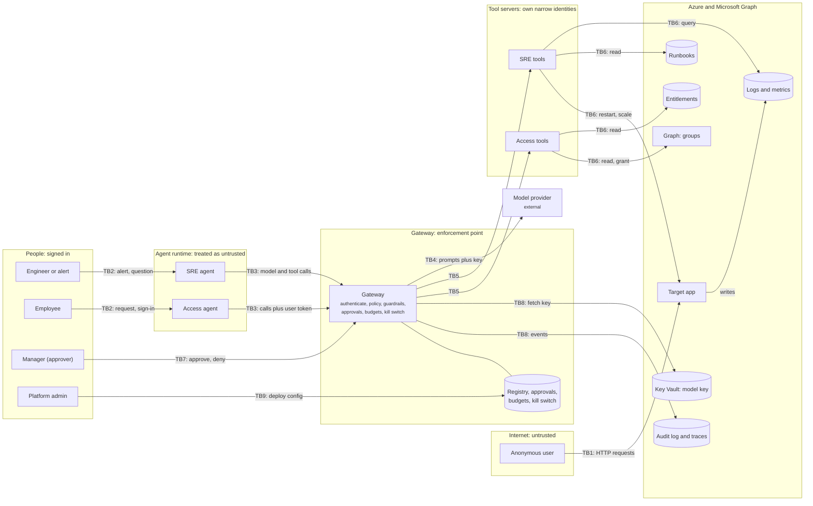

# Threat model

Version 1 (draft) · step 1.1 · started 2026-10-23

This document answers four questions for the Agent Governance Gateway and the two agents it protects: what are we building, what can go wrong, what will we do about it, and how will we know it works. Every threat names a planned control, the test that will prove it, and the plan step that builds it.

It describes the **target system** (Phases 1–6), not only what exists today. Parts of the design are still open; they are marked as such and the model is updated when they are decided.

**Method** (ADR 0006): draw the data flows and trust boundaries, apply STRIDE at each boundary, and tag each threat with its OWASP (LLM Top 10 2025, Agentic Top 10 2026) and Google SAIF categories. Likelihood and impact are rated Low / Medium / High.

## 1. Scope

**In scope:** the gateway, the SRE agent, the access-request agent, their tool servers, the target app they operate on, and the Azure and Microsoft Graph resources those tools touch.

**Out of scope for v1:**

- The coding agent used to build this project, and CI. They have their own controls (ADR 0004, repository rulesets, secret scanning).
- The security of Azure, Entra ID and the model provider's own infrastructure. We trust them, and record that as an accepted risk.
- A compromised maintainer laptop or Azure admin account. Whoever holds these owns the tenant anyway.

**Assumptions** (each is checked by a later step):

- Agents reach models and tools only through the gateway (proved in 1.5).
- Agents hold no secrets; the model key lives in Key Vault and only the gateway uses it (3.6).
- Tool servers act on Azure and Graph with their own narrow identities, never the agent's (6.2, 4.2).

## 2. The system

### Assets: what is worth protecting

| ID | Asset | What we care about |
|---|---|---|
| A01 | Target app | Stays up; is only restarted or scaled when that is the right fix |
| A02 | Group memberships in Entra ID | Only entitled people get access; privileged groups above all |
| A03 | Model API key | Never leaves Key Vault and the gateway |
| A04 | Identities and tokens: agent identities, tool-server managed identities, users' delegated tokens | Cannot be stolen, replayed or used by anyone else |
| A05 | Data the agents read: logs (may contain secrets and personal data), metrics, runbooks, entitlements, group details | Not leaked outside its audience |
| A06 | Gateway configuration: agent registry, approval records, budget counters, kill-switch flag | Only the platform admin can change it |
| A07 | Audit log and traces | Complete and unchangeable; the evidence of what happened |
| A08 | Money: model tokens and Azure spend | Bounded per agent and per run |
| A09 | Approvers' attention | Not worn down by floods of requests or misleading summaries |

### Actors: who is involved

| Actor | Trust | Notes |
|---|---|---|
| Engineer on call | Trusted | Starts SRE triage, reads its report |
| Alert system | Trusted source, untrusted content | Alert text can quote logs |
| Employee | Signed in, partly trusted | Uses the access agent; may be a malicious insider |
| Manager | Signed in, trusted to approve | Approves requests for groups they own |
| Platform admin (the maintainer) | Trusted | Owns gateway config, Terraform and the tenant |
| Anonymous internet user | Untrusted | Can send requests to the target app, and so write into its logs |
| Content author | Partly trusted | Anyone who can edit runbooks, alert rules, group descriptions or ticket text |
| Third-party code | Partly trusted | MCP SDKs, Python packages, a tool server we did not write |
| Model provider | Trusted with prompts | Sees everything the agents send to the model |
| **A hijacked agent** | **Untrusted** | The design assumes any agent can be turned by injected text, so the gateway treats agents as untrusted callers |

### Entry points: where input comes in

| ID | Entry point | Who controls the content |
|---|---|---|
| E01 | SRE trigger: an alert payload or an engineer's question | Alert system, engineer |
| E02 | Target app's public HTTP endpoints (headers, URL, form fields, login names) | **Anyone on the internet**; this text lands in logs |
| E03 | Runbooks | Content authors |
| E04 | Access request typed by a user | The employee |
| E05 | Group names and descriptions; request and ticket text | Content authors, employees |
| E06 | Tool results returned to the agent (carries E02, E03 and E05) | Whoever wrote the underlying data |
| E07 | Tool descriptions (`tools/list`) | Whoever wrote or controls the tool server |
| E08 | Model responses, including the tool calls the model asks for | The model, steered by everything above |
| E09 | Gateway API (agent calls) | Agents, or anything that can reach the gateway |
| E10 | Approval endpoint | Managers, or anyone who can reach it |
| E11 | User sign-in (leaning: device code flow) | The user; also a phishing target |
| E12 | Target app's chaos toggles (authenticated) | The maintainer |
| E13 | Gateway configuration and deployment | The platform admin, via Terraform and the repo |

### Trust boundaries

A **trust boundary** is a line where data passes between parts we trust differently. Checks belong at these lines, and threats cluster there.

| ID | Boundary | What crosses it |
|---|---|---|
| TB1 | Internet ↔ target app | Anonymous HTTP requests, which end up in logs |
| TB2 | People ↔ agents | Questions, access requests, sign-in; reports and answers back |
| TB3 | Agents ↔ gateway | Every model call and tool call. **The main enforcement line** |
| TB4 | Gateway ↔ model provider | Full prompts (including tool results) and the API key; responses back |
| TB5 | Gateway ↔ tool servers | Tool calls with arguments; tool results back |
| TB6 | Tool servers ↔ Azure and Graph | Log queries, restart and scale, group reads and grants |
| TB7 | Approvers ↔ gateway | Approve and deny decisions |
| TB8 | Gateway ↔ Key Vault and the audit store | Key fetch; audit events and traces out |
| TB9 | Platform admin ↔ gateway configuration | Registry, policies, budgets, kill switch |

### Data-flow diagram

Still open, and drawn as the current leaning: where entitlements and runbooks are stored (4.1, 1.2), whether model calls pass through the gateway (D10, 1.5), and which identity executes an approved grant (4.2).

### The round trip

The most important path in this picture does not start at the top. An anonymous user sends a request with a crafted header (TB1). The app logs it. Later, the SRE tool server reads that log (TB6) and returns it through the gateway (TB5) to the agent, which sends it to the model (TB4) as part of the prompt. Untrusted text has entered the model's context **from the bottom of the stack**, through a tool result, without the attacker ever talking to the agent.

The same happens to the access agent through group descriptions and ticket text. This is why tool results are treated as untrusted input (E06), and why the gateway checks what agents try to **do**, not only what they are told.

## 3. Threats

To be written next: one row per threat, found by walking each boundary above with STRIDE.

## 4. Accepted risks

To be written with the threats.

## 5. Change log

| Date | Change |
|---|---|
| 2026-10-23 | v1 draft: scope, assets, actors, entry points, trust boundaries, data-flow diagram |
